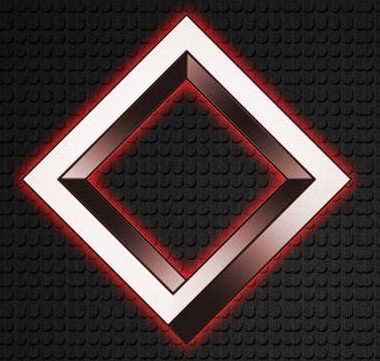

<p align="center">
  
</p>

<h1 align="center">Aabhas</h1>

<p align="center">
  Enterprise out-of-core tensor streaming for large language model inference.
</p>

<p align="center">
  
  
  
  
</p>

---

## System Overview

Aabhas is an out-of-core inference engine designed for large language models whose aggregate parameter weights exceed physical host RAM or GPU VRAM capacity. Rather than requiring entire model weights to be resident in memory, the engine streams individual tensor layers sequentially from high-throughput NVMe storage into bounded execution arenas, computes forward passes, and evicts pages from the working set.

The system enforces strict architectural boundaries across three programming environments:

```
[ Go Control Plane ]       --- HTTP / REST, CLI, RBAC Auth, Continuous Batching, Model Pool
         |||
[ Rust Safety Grid ]       --- Panic-Safe C ABI, Hardware UUID License Gate, RAM & NVMe Preflight
         |||
[ C++17 Data Plane ]       --- POSIX fd / O_DIRECT, mmap Illusion, Quantized SIMD, Layer Streamer
```

---

## Architecture and Subsystem Isolation

The execution pipeline partitions failure domains and memory ownership across isolated boundaries:

```text
 +-----------------------------------------------------------------------------------+
 |                                 Client / Proxy                                    |
 +------------------------------------------+----------------------------------------+
                                            |
                                  Bearer Token / RBAC
                                            v
 +-----------------------------------------------------------------------------------+
 |                                Go Control Plane                                   |
 |  - REST API & Token Manager (CSPRNG, SHA-256 verification, Role-Based Access)    |
 |  - In-flight Continuous Batch Scheduler & Dynamic Request Queue                   |
 |  - Multi-Model Pool (LRU Eviction, Memory Tracking, Concurrent Leases)            |
 |  - Hardware Compatibility Evaluator & Benchmark Expositions                       |
 |  - Prometheus Metrics Exporter & Structured Health Probes (/healthz, /readyz)     |
 +------------------------------------------+----------------------------------------+
                                            |
                                     Cgo / C ABI Call
                                            v
 +-----------------------------------------------------------------------------------+
 |                                Rust Safety Grid                                   |
 |  - Panic Boundary (catch_unwind across FFI, deterministic integer status codes)  |
 |  - Physical Host RAM Guard (Rejects admission when host usage >= 70%)             |
 |  - NVMe Storage Reserve Probe (Mandates >= 20 GiB available storage blocks)       |
 |  - Node Identity Gate (Hardware UUID normalization & Ed25519 signature checks)   |
 +------------------------------------------+----------------------------------------+
                                            |
                                      Native Entry
                                            v
 +-----------------------------------------------------------------------------------+
 |                                C++17 Data Plane                                   |
 |  - Storage Layer: NvmeDirectReader (POSIX O_DIRECT) & MemoryIllusionist (mmap)    |
 |  - Streaming Engine: LayerStreamer with MADV_SEQUENTIAL and MADV_DONTNEED hints   |
 |  - Quantized Kernels: SIMD Dot Products for FP16, Q4_0, Q4_1, Q8_0 Block Formats  |
 |  - Transformer Execution: RoPE, RMSNorm, SwiGLU, Grouped-Query Attention (GQA)    |
 |  - Generation Loop: Bounded KV Cache, Autoregressive Decode, Dynamic Stop Tokens  |
 |  - Sampling: Temperature, Top-K, Top-P, Min-P, Repetition Penalties, Streaming   |
 |  - Acceleration: Multi-Backend VRAM Allocator (CUDA / ROCm / Vulkan abstraction)  |
 |  - Model Integrity: Streaming FIPS 180-4 SHA-256 Verifier for GGUF & SafeTensors |
 +-----------------------------------------------------------------------------------+
```

### Subsystem Boundaries

| Subsystem | Primary Responsibilities | Failure Boundary | Invariant Guarantees |
| :--- | :--- | :--- | :--- |
| **Go Control Plane** | HTTP routing, request decoding, RBAC validation, batch scheduling, model lifecycle. | Process crash / HTTP 5xx | Never copies or buffers raw tensor weights in Go runtime heaps. |
| **Rust Safety Grid** | Preflight RAM capacity checks, storage quotas, hardware licensing, FFI ABI isolation. | Deterministic negative error codes | Catches panics; never allows unhandled Rust unwinding to cross C ABI. |
| **C++17 Data Plane** | Storage I/O, page mapping, SIMD quantization kernels, transformer attention, KV cache. | Standard OS signals / error states | Pre-allocates working arenas; executes decode loops with zero heap allocations. |

---

## Technical Phase Specifications

All core functional components are specified and verified across 10 architectural phases. Detailed specifications and implementation documentation are linked below:

| Phase | Subsystem | Implementation Scope | Documentation Blob Link |
| :---: | :--- | :--- | :--- |
| **01** | Model Loaders | SafeTensors & GGUF metadata parsing, tensor offset mapping, zero-copy indexing. | [`docs/product-phase-1-model-formats.md`](https://github.com/Voxion-Labs/Aabhas/blob/main/docs/product-phase-1-model-formats.md) |
| **02** | Tokenizer | Byte-Pair Encoding (BPE), SentencePiece, UTF-8 normalization, special token tables. | [`docs/product-phase-2-tokenizer.md`](https://github.com/Voxion-Labs/Aabhas/blob/main/docs/product-phase-2-tokenizer.md) |
| **03** | Transformer Layers | Grouped-Query Attention (GQA), RoPE positional embeddings, SwiGLU MLP, RMSNorm. | [`docs/product-phase-3-transformer-layers.md`](https://github.com/Voxion-Labs/Aabhas/blob/main/docs/product-phase-3-transformer-layers.md) |
| **04** | Quantized Compute | Vectorized SIMD dot-product kernels for `FP16`, `Q4_0`, `Q4_1`, and `Q8_0` block formats. | [`docs/product-phase-4-quantized-kernels.md`](https://github.com/Voxion-Labs/Aabhas/blob/main/docs/product-phase-4-quantized-kernels.md) |
| **05** | KV Cache & Generation | Pre-allocated circular KV buffers, autoregressive prompt prefill and token decode loops. | [`docs/product-phase-5-kv-cache-token-generation.md`](https://github.com/Voxion-Labs/Aabhas/blob/main/docs/product-phase-5-kv-cache-token-generation.md) |
| **06** | Sampling & Streaming | Temperature, Top-K, Top-P, Min-P, repetition penalty, dynamic stop sequences, token callbacks. | [`docs/product-phase-6-sampling-streaming.md`](https://github.com/Voxion-Labs/Aabhas/blob/main/docs/product-phase-6-sampling-streaming.md) |
| **07** | Acceleration & VRAM | Hardware backend abstraction (CUDA / ROCm / Vulkan), unified memory, hybrid CPU offload. | [`docs/product-phase-7-gpu-vram-backend.md`](https://github.com/Voxion-Labs/Aabhas/blob/main/docs/product-phase-7-gpu-vram-backend.md) |
| **08** | Multi-Model & Batching | In-flight continuous sequence batching, multi-model LRU memory pool, execution leases. | [`docs/product-phase-8-multi-model-batching.md`](https://github.com/Voxion-Labs/Aabhas/blob/main/docs/product-phase-8-multi-model-batching.md) |
| **09** | Hardware & Benchmarks | Execution tier classifier (`FullGpu`, `HybridGpuOffload`, `CpuRam`, `NvmeOutofCore`), microbenchmarks. | [`docs/product-phase-9-benchmarking-hardware.md`](https://github.com/Voxion-Labs/Aabhas/blob/main/docs/product-phase-9-benchmarking-hardware.md) |
| **10** | Identity & Provenance | CSPRNG RBAC tokens, Ed25519 hardware node licensing, FIPS 180-4 SHA-256 tensor verification. | [`docs/product-phase-10-production-identity.md`](https://github.com/Voxion-Labs/Aabhas/blob/main/docs/product-phase-10-production-identity.md) |

---

## Core Execution Mechanics

### 1. Zero-Allocation Autoregressive Step
During generation, `TokenGenerator` operates over pre-allocated workspace arenas. Context structures, layer activations, projection vectors, and KV caches are pinned upfront. The inner decode loop executes matrix-vector operations, layer normalization, residual accumulation, and logit sampling without invoking heap memory managers (`malloc`/`new`).

### 2. Virtual Memory Illusion & Layer Streaming
To run models exceeding RAM size, `MemoryIllusionist` maps individual layer offsets from storage using `mmap`. `LayerStreamer` instructs the Linux kernel on access patterns:
* Forward prefetch: issues `madvise(MADV_SEQUENTIAL)` and `POSIX_FADV_WILLNEED` on adjacent layer windows.
* Working set release: invokes `madvise(MADV_DONTNEED)` immediately after completing forward compute on a layer, allowing kernel page reclaim before the next layer is mapped.

### 3. Quantized SIMD Kernels
Inference execution supports unquantized Float32 as well as packed block formats:
* `Q4_0`: 32 4-bit signed nibbles sharing a single 16-bit float scale factor.
* `Q4_1`: 32 4-bit unsigned nibbles with a 16-bit float scale and 16-bit float minimum offset.
* `Q8_0`: 32 8-bit signed integer values with a 16-bit float scale.
* `FP16` / `BF16`: Half-precision IEEE 754 floating-point conversion and dot products.

Kernels compute dot products directly across quantized blocks with AVX2/AVX-512 FMA vectorization where supported, minimizing intermediate conversions.

### 4. Continuous In-Flight Batching
The batch scheduler manages multiple concurrent generation requests concurrently. Requests dynamically transition through `WAITING`, `PREFILLING`, `GENERATING`, `COMPLETED`, or `STOPPED`. Prefill tokens and single-step decode operations are scheduled in unified forward batches, maximizing memory bandwidth saturation across active sequences.

### 5. Multi-Model Pool
Multiple models can be registered and hosted simultaneously via `ModelPool`. Model instances are managed under an LRU eviction policy governed by configurable memory thresholds. Weights and static configurations are shared across active inference sessions.

---

## Hardware Compatibility and Execution Tiers

The engine inspects available hardware topology (CPU cores, vector extensions, host RAM, GPU devices, dedicated VRAM, and NVMe read throughput) to assign models to deterministic execution tiers:

```
+-------------------------------------------------------------------------------------+
|                               Hardware Assessment                                   |
+---------------------+-------------------+---------------------+---------------------+
|      FullGpu        | HybridGpuOffload  |       CpuRam        |   NvmeOutofCore     |
+---------------------+-------------------+---------------------+---------------------+
| Model weights, KV   | Active layers or  | Model resident in   | Model exceeds RAM;  |
| cache & activations | KV cache in VRAM; | host RAM; SIMD      | streamed layer by   |
| fit entirely inside | remaining weights | quantized execution | layer from NVMe     |
| discrete GPU VRAM.  | in host RAM/NVMe. | on host CPU cores.  | via virtual memory. |
+---------------------+-------------------+---------------------+---------------------+
```

Topology evaluation is exposed via CLI (`aabhas-cli hwcheck`) and REST endpoint (`POST /api/v1/hardware/compatibility`).

---

## Security, Licensing, and Model Provenance

### Role-Based Access Control (RBAC)
Control plane requests are authenticated via Bearer tokens generated from a cryptographically secure pseudorandom number generator (CSPRNG). Tokens are stored as SHA-256 digests and verified using constant-time string comparisons.

Four hierarchical roles enforce principle of least privilege:
* `admin`: Complete cluster access, token management, engine lifecycle start/stop.
* `operator`: Model registration, hardware verification, benchmarking, license evaluation.
* `inference`: Model listing, token generation, streaming inference pipelines.
* `auditor`: Status queries, non-sensitive readiness probes, Prometheus metrics scraping.

### Hardware-Bound Licensing
Enterprise deployments can enforce hardware-locked execution nodes. Aabhas normalizes system board, chassis, and CPU serial signatures into a deterministic hardware UUID. Licenses are signed with standard Ed25519 asymmetric cryptography and verified across the Rust safety grid prior to engine startup.

### Cryptographic Model Integrity
To prevent model supply-chain tampering or storage bitrot, the engine includes a streaming FIPS 180-4 SHA-256 verifier. It calculates deterministic digests across raw tensor files and verifies canonical model manifests (`ModelManifest`) without buffering entire models in memory.

---

## Repository Layout

```text
core-engine/                  C++17 data plane and Rust safety grid
  ├── include/                Data plane headers (models, tensors, scheduler, kernels)
  ├── src/                    C++ engine implementation and streaming layers
  ├── rust_trap/              Rust cdylib (panic handling, memory and storage gates)
  └── tests/                  15 CTest unit and integration suites
control-plane/                Go daemon, CLI, API, and orchestration
  ├── cmd/aabhas-cli/         CLI interface (lifecycle, hardware check, licensing, verify)
  ├── cmd/aabhas-daemon/      HTTP daemon with RBAC and continuous batching
  └── internal/               API handlers, orchestrator, model pool, auth, license
ffi-bridge/                   C ABI header definitions and FFI bindings
stealth-deploy/               Production Dockerfile and Kubernetes deployment manifests
sandbox/                      Isolated dev environments and VM setup tooling
tests/                        Valgrind memory leak checks and end-to-end audit scripts
docs/                         Architecture specifications and Phase 1-10 documentation
scripts/                      Release automation, build validation, and dev setup
```

---

## Build Prerequisites

Building Aabhas from source requires:
* **C++ Compiler:** GCC 11+ or Clang 14+ supporting C++17.
* **Build System:** CMake 3.16+ and GNU Make.
* **Rust:** Rust 1.75+ (Cargo) with `cdylib` target.
* **Go:** Go 1.22+ for the control plane.
* **Platform:** Linux (x86_64 or aarch64) with POSIX compliance.

To build all tiers locally:

```bash
# 1. Compile C++ data plane and Rust safety grid
make build-core

# 2. Compile Go daemon and CLI
make build-go
```

To build a deterministic, stripped production release archive:

```bash
AABHAS_RELEASE_VERSION=v1.0.0 ./scripts/build_release.sh
```

---

## Operation and Control Surface

### Command Line Interface (`aabhas-cli`)

The bundled CLI provides complete administrative control over local and remote daemon instances:

```bash
# Evaluate local hardware compatibility against a model
./bin/aabhas-cli hwcheck -model /models/llama-3-8b.gguf -ctx 4096 -batch 4

# Run microbenchmarks on quantized compute kernels and decode runtime
./bin/aabhas-cli benchmark -type kernels -dim 4096 -iters 200

# Generate an Ed25519 keypair for enterprise licensing
./bin/aabhas-cli keygen -out license_keys.json

# Generate and verify a node-locked hardware license
./bin/aabhas-cli license generate -key private.pem -uuid 550e8400-e29b-41d4-a716-446655440000 -tier enterprise
./bin/aabhas-cli license verify -key public.pem -license node.lic

# Verify cryptographic SHA-256 manifest and tensor integrity
./bin/aabhas-cli verify-model -model /models/llama-3-8b.gguf

# Start an engine lifecycle lease
./bin/aabhas-cli start -addr 127.0.0.1:8080 -model /models/llama-3-8b.gguf

# Query status and inspect active models
./bin/aabhas-cli status -addr 127.0.0.1:8080

# Gracefully terminate active execution
./bin/aabhas-cli stop -addr 127.0.0.1:8080
```

### Control Plane REST Endpoints

The Go daemon listens by default on `127.0.0.1:8080`. When authentication is enabled, requests require `Authorization: Bearer <token>`.

| Route | Method | Required Role | Description |
| :--- | :---: | :---: | :--- |
| `/api/v1/engine/start` | `POST` | `admin` | Commences native engine execution lease for a model path. |
| `/api/v1/engine/stop` | `POST` | `admin` | Evicts active execution and releases data plane memory mappings. |
| `/api/v1/engine/status` | `GET` | `auditor` | Returns engine lifecycle counters, lease state, and uptime. |
| `/api/v1/models` | `POST` | `inference` | Registers and validates model file descriptors in registry. |
| `/api/v1/models` | `GET` | `inference` | Lists registered model metadata and supported tensor types. |
| `/api/v1/hardware/compatibility` | `POST` | `operator` | Evaluates topology and predicts required execution tier. |
| `/api/v1/benchmark` | `POST` | `operator` | Executes synchronous compute and memory throughput tests. |
| `/api/v1/auth/tokens` | `POST` | `admin` | Provisions, rotates, or revokes scoped RBAC tokens. |
| `/api/v1/license/verify` | `POST` | `operator` | Verifies node hardware UUID against cryptographic license. |
| `/api/v1/models/verify` | `POST` | `operator` | Verifies FIPS 180-4 SHA-256 tensor hash manifest integrity. |
| `/metrics` | `GET` | `auditor` | Exposes Prometheus format counters, latencies, and gauges. |
| `/healthz` | `GET` | *Public* | Liveness probe indicating daemon HTTP process is alive. |
| `/readyz` | `GET` | *Public* | Readiness probe indicating daemon is initialized and accepting requests. |

---

## Test Suites and Quality Verification

The repository enforces deterministic quality checks across the entire stack:

```bash
# Execute native CTest suite, Rust safety tests, and Go race test suite
make test
```

### Verification Matrix

* **15 C++ CTests:**
  1. `aabhas_model_index_test`: GGUF & SafeTensors metadata, tensor headers, corrupt input rejection.
  2. `aabhas_layer_scheduler_test`: Sequential window advancement, prefetch hints, rewind verification.
  3. `aabhas_inference_runtime_test`: Streaming matrix-vector dot products, layer memory arenas.
  4. `aabhas_tokenizer_test`: BPE / SentencePiece tokens, byte fallbacks, special token handling.
  5. `aabhas_transformer_layers_test`: RoPE rotation, RMSNorm, SwiGLU MLP, multi-head attention.
  6. `aabhas_transformer_block_test`: Complete pre-norm transformer decoder block forward pass.
  7. `aabhas_quantized_kernels_test`: Mathematical accuracy across `FP16`, `Q4_0`, `Q4_1`, and `Q8_0`.
  8. `aabhas_token_generator_test`: Prefill and autoregressive token generation with KV cache.
  9. `aabhas_sampling_test`: Deterministic greedy, top-K, top-P, temperature, and penalty transforms.
  10. `aabhas_gpu_backend_test`: GPU buffer allocation, device memory tracking, and fallback tiers.
  11. `aabhas_batch_scheduler_test`: Concurrent multi-sequence in-flight batching and early stops.
  12. `aabhas_model_pool_test`: LRU model caching, concurrent model leases, working set eviction.
  13. `aabhas_hw_compatibility_test`: Automated topology scoring and memory calculation accuracy.
  14. `aabhas_benchmark_test`: Microbenchmark measurement loops, throughput and latency metrics.
  15. `aabhas_model_integrity_test`: FIPS 180-4 SHA-256 test vectors, tamper detection, manifest hashing.
* **Rust Unit Tests:** Memory percentage thresholds (>=70% rejection), filesystem block capacity (>=20 GiB reserve), and Ed25519 signature validation.
* **Go Race-Free Tests:** Multi-threaded REST route validation, token manager synchronization, continuous batch scheduler queues, and memory pool eviction.
* **Security & Memory Leak Audits:** Valgrind dynamic memory leak check (`./tests/security_audits/run_valgrind.sh`) runs zero-leak verification across C++ layer streamer.

---

## Production Deployment and Hardening

The production container configuration enforces defense-in-depth isolation:

* **Non-Root Execution:** Runs under dedicated unprivileged UID/GID `65532:65532`.
* **Read-Only Root Filesystem:** Root filesystems are mounted read-only; mutable state is restricted to ephemeral `tmpfs` mounts.
* **Minimal Linux Capabilities:** Drops all capabilities by default, retaining only `CAP_IPC_LOCK` when page pinning is enabled.
* **Storage Access:** Model repositories are mounted read-only via high-speed NVMe block storage.
* **Kubernetes Orchestration:** Production manifests (`stealth-deploy/kubernetes/`) provide standard DaemonSets/Deployments with native `/healthz` and `/readyz` probes.

To build the production container image:

```bash
docker build -f stealth-deploy/Dockerfile.prod -t aabhas:latest .
```

---

## Documentation Index

Comprehensive engineering specifications are maintained in the [`docs/`](https://github.com/Voxion-Labs/Aabhas/tree/main/docs) directory:

* [`docs/architecture.md`](https://github.com/Voxion-Labs/Aabhas/blob/main/docs/architecture.md) — Comprehensive technical architecture specification.
* [`docs/api_reference.md`](https://github.com/Voxion-Labs/Aabhas/blob/main/docs/api_reference.md) — HTTP REST control plane reference.
* [`docs/product-phase-1-model-formats.md`](https://github.com/Voxion-Labs/Aabhas/blob/main/docs/product-phase-1-model-formats.md) — Phase 1: Model Format Loaders & Indexing.
* [`docs/product-phase-2-tokenizer.md`](https://github.com/Voxion-Labs/Aabhas/blob/main/docs/product-phase-2-tokenizer.md) — Phase 2: Tokenization Engine.
* [`docs/product-phase-3-transformer-layers.md`](https://github.com/Voxion-Labs/Aabhas/blob/main/docs/product-phase-3-transformer-layers.md) — Phase 3: Transformer Layers & Attention.
* [`docs/product-phase-4-quantized-kernels.md`](https://github.com/Voxion-Labs/Aabhas/blob/main/docs/product-phase-4-quantized-kernels.md) — Phase 4: Quantized CPU SIMD Kernels.
* [`docs/product-phase-5-kv-cache-token-generation.md`](https://github.com/Voxion-Labs/Aabhas/blob/main/docs/product-phase-5-kv-cache-token-generation.md) — Phase 5: KV Cache & Autoregressive Decoding.
* [`docs/product-phase-6-sampling-streaming.md`](https://github.com/Voxion-Labs/Aabhas/blob/main/docs/product-phase-6-sampling-streaming.md) — Phase 6: Sampling Strategies & Streaming.
* [`docs/product-phase-7-gpu-vram-backend.md`](https://github.com/Voxion-Labs/Aabhas/blob/main/docs/product-phase-7-gpu-vram-backend.md) — Phase 7: GPU Acceleration & VRAM Allocator.
* [`docs/product-phase-8-multi-model-batching.md`](https://github.com/Voxion-Labs/Aabhas/blob/main/docs/product-phase-8-multi-model-batching.md) — Phase 8: Multi-Model Pool & Continuous Batching.
* [`docs/product-phase-9-benchmarking-hardware.md`](https://github.com/Voxion-Labs/Aabhas/blob/main/docs/product-phase-9-benchmarking-hardware.md) — Phase 9: Hardware Compatibility & Benchmarking.
* [`docs/product-phase-10-production-identity.md`](https://github.com/Voxion-Labs/Aabhas/blob/main/docs/product-phase-10-production-identity.md) — Phase 10: Production Identity & Model Provenance.

---

## License

See [`LICENSE`](https://github.com/Voxion-Labs/Aabhas/blob/main/LICENSE) for distribution terms.

<br>
<div align="right">
  <b>Rudranarayan Jena</b><br>
  <i>Founder @ Voxion Labs</i>
</div>

---
<div align="center">
  (c) 2026 Voxion Labs & Rudranarayan Jena
</div>
